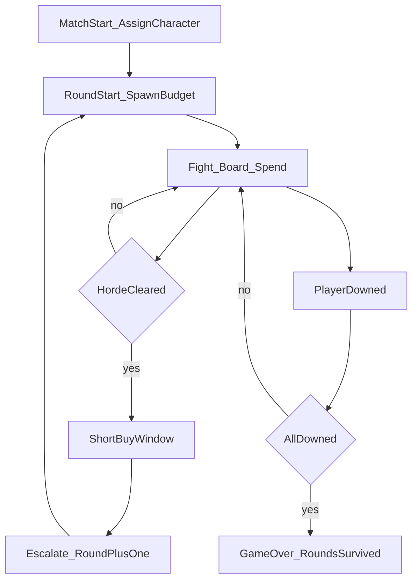
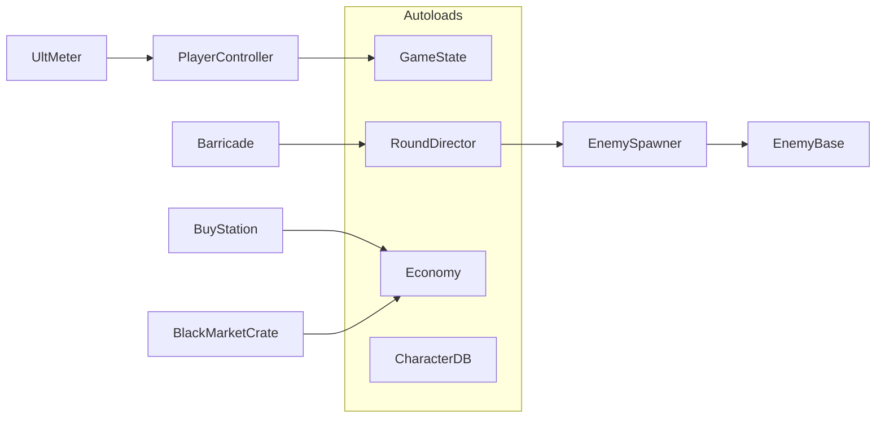
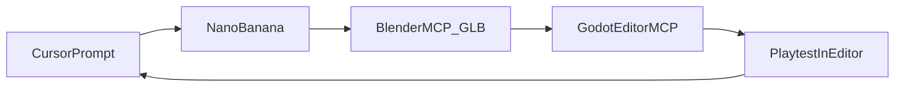

# Arena of Stonksness — Setup + Game Plan

## Locked decisions

- **Engine:** Godot **4.4 or newer**, **Standard** build, **GDScript only**. Godot Editor MCP needs 4.4+. Web single-thread export needs 4.3+. C# cannot export to the browser.
- **Renderer:** **Compatibility** (WebGL 2.0) from the first project setting. Forward+ and Mobile do not run on the web. Switching later changes how materials look.
- **Play now:** **1 player, local**, then the same build exported for the browser.
- **Ship target:** playable at a path on **rbyt3r.com**. The site only serves static files. The match runs in the visitor's browser.
- **Co-op later:** up to 4 players over **WebRTC**. One player is the listen-server. rbyt3r.com does not simulate the horde. A tiny signaling step is the only extra process, and it waits until co-op.
- **Art:** Borderlands-like caricature, but cheap enough for WebGL. Ink lines live **in the textures**. Characters get a simple inverted-hull outline. No Forward+ post-process outline.
- **Art generation:** **Nano Banana** (Gemini image MCP). The API key lives only in the Windows user variable `GEMINI_API_KEY`. It is not written into this file, `mcp.json`, or git.
- **Automation:** Cursor drives **mcp-for-blender** (Blender), **Nano Banana** (concepts and textures), and **Godot Editor MCP** (live editor). You still playtest and call out feel changes.
- **First content:** one two-floor building. Small download on purpose.

Working title: **Arena of Stonksness** / **Broke vs. Broker**. No Call of Duty names.

---

## What we took from the other planning chat

Kept, because Godot's own docs agree:

- Browser build uses the **Compatibility** renderer only.
- Export with **Thread Support off** (the default since Godot 4.3). No COOP/COEP headers, so a normal static folder works on modest hardware.
- **GDScript only.**
- The server should **not** run the game. Visitors download `index.html`, `.js`, `.wasm`, and `.pck`, then play locally.
- Later multiplayer is **WebRTC**, not UDP. Browsers cannot do raw UDP/TCP. A listen-server (one player hosts) keeps your box out of the simulation.
- Browser limits to design for: a **click-to-start** screen (audio and mouse capture only work after a click), and a note that background tabs pause the game.

Rejected:

- **BlendBridge.** Real, but tiny (a couple of GitHub stars) and pinned to Blender 5.0. The established free tool is [mcp-for-blender](https://github.com/ahujasid/mcp-for-blender) (formerly `blender-mcp`; `uvx blender-mcp` still runs it).
- **GameForge.** Paid suite. Not needed.
- **GenosDB** and other "serverless multiplayer" plugins. When co-op starts, use Godot's own WebRTC classes plus a small signaling server, not an extra vendor.

---

## Phase 1 — Toolchain setup (do this first)

### 1A. Godot

1. Install **Godot 4.4 or newer Standard** from [godotengine.org/download](https://godotengine.org/download). 4.2/4.3 are too old for Godot Editor MCP. 3.x can stay installed beside 4.x.
2. Help → About Godot. Note the exact version string.
3. Create a new project in `c:\Users\sudol\arenaOfStonksness`.
4. Project Settings → Rendering → Renderer → **Compatibility**. Do this before any art.

### 1B. Blender + mcp-for-blender

1. Install **Blender 4.x** from [blender.org](https://www.blender.org/download/).
2. Install **uv** in PowerShell: `irm https://astral.sh/uv/install.ps1 | iex`
3. Install the addon from [ahujasid/mcp-for-blender](https://github.com/ahujasid/mcp-for-blender): Edit → Preferences → Add-ons → Install → enable it.
4. In Blender: **N** panel → Blender MCP → **Start MCP Server** (port `9876`). Leave Blender open while assets are built.
5. Add the server in Cursor (project `.cursor/mcp.json` or user `~/.cursor/mcp.json`). Start with Blender only:

```json
{
  "mcpServers": {
    "blender": {
      "command": "uvx",
      "args": ["blender-mcp"]
    }
  }
}
```

6. Restart Cursor → Settings → Tools & MCP → `blender` connected.
7. Smoke test: "List objects in the current Blender scene."
8. Only one Blender MCP client at a time.

### 1C. Godot Editor MCP

Free live-editor bridge: [hybridindie/godot-mcp](https://github.com/hybridindie/godot-mcp). Package name is `godot-editor-mcp`. It needs the Godot project from 1A, Godot **4.4+**, and Python 3.11+ via uv.

1. Install the server: `uv tool install godot-editor-mcp`
2. Copy its Godot addon into the project's `addons/` folder and enable it in Project → Project Settings → Plugins. Leave the Godot editor open.
3. Add it beside Blender in `mcp.json`. Point `command` at the `godot-editor-mcp` executable `uv tool install` put on your PATH (often under `%USERPROFILE%\.local\bin`).
4. Restart Cursor and confirm the Godot server is connected.
5. Smoke test: "List the nodes in the current Godot scene."

Godot MCP is for assembly and playtests. It does not invent the game without direction.

### 1D. Nano Banana (Gemini image MCP)

Art server: [ConechoAI/Nano-Banana-MCP](https://github.com/ConechoAI/Nano-Banana-MCP), run with `npx -y nano-banana-mcp`.

The Gemini key is already stored as the Windows **user** environment variable `GEMINI_API_KEY` on this PC (Google project number `151409159764`). It is not in this file or in git.

1. Fully quit and reopen Cursor so it inherits `GEMINI_API_KEY`. The variable is already set, so do not paste the key again.
2. Add this next to the other servers in `mcp.json`. No key in the file. The process inherits `GEMINI_API_KEY`.

```json
"nano-banana": {
  "command": "npx",
  "args": ["-y", "nano-banana-mcp"]
}
```

3. Restart Cursor → Settings → Tools & MCP → `nano-banana` connected.
4. Smoke test: a Borderlands-style dirty brick albedo, square, ink lines in the image, meant to tile.
5. If the call is rejected, enable the Generative Language API on that Google Cloud project and retry. If the key was pasted into a chat, revoke it in Google AI Studio and put the replacement only in the user variable.

Pipeline for each asset:

1. Nano Banana generates a Borderlands-style concept or a tileable albedo (ink lines drawn into the image).
2. Blender MCP builds a modest mesh, applies that image, exports **GLB** (Y-up, modifiers applied).
3. Godot Editor MCP imports the GLB into the Compatibility project.

**Phase 1 exit:** Godot 4.4+ Compatibility project exists, Blender MCP answers, Godot Editor MCP answers, Nano Banana returns an image.

---

## Ship target — rbyt3r.com

v1 adds **zero game processes** on your hardware.

| Choice | Why |
|---|---|
| Compatibility renderer | Only renderer that runs in the browser |
| Thread Support **off** | No SharedArrayBuffer headers. Any static host works |
| Extensions Support **off** | Same header requirement if left on |
| GDScript only | C# web export does not exist |
| Static files only | `index.html`, `.js`, `.wasm`, `.pck` |
| Click-to-start page | Unlocks audio and mouse look |
| gzip or brotli on the web server | Smaller download. Cost is once at request time, not during play |

Export later with Project → Export → Web, main file named `index.html`, into its own folder. Do not open that file by double-click. Test with Godot's Run in Browser, or `python -m http.server`.

**Load budget (first map):** Godot's wasm is the heavy part. Keep our content small so the page still comes up fast:

- One building, shared materials
- Tileable walls at **512 px**
- Character textures at **1024 px** max, ideally one atlas per character
- Low-to-mid poly caricatures, not sculpted film meshes
- Few unique enemy meshes; recolor archetypes (tax collector, broker, king) instead of a new model every round

**Co-op (phase 10, not v1):** WebRTC data channels. One player hosts the round. Others connect peer-to-peer. A small WebSocket only exchanges the connection handshake, then gameplay does not flow through rbyt3r.com. If that extra process is too much for the box, co-op waits. Desktop UDP is not an option for the website build.

---

## Fantasy and legal distinctiveness

Broke survivors hold a rundown multi-story hangout while waves of rich caricatures (tax collectors, kings, stockbrokers, landlords, lobbyists) try to take their cash. Rounds get meaner. Cash buys guns, lasting upgrades, and a gambling weapon crate.

Safe to share with the genre: round hordes, boarding openings, buy stations, a random weapon crate, escalating difficulty, special abilities.

Keep it ours:

- Original names. No Pack-a-Punch, Juggernog, Quick Revive, Ray Gun, Mystery Box, or CoD map titles.
- Living rich archetypes, not undead soldiers.
- Original layout, UI, and stingers.
- Borderlands-like ink, not military realism.

Names we will use:

- Random weapon: **Black Market Crate**
- Small gun mods: **Street Smith**
- Version upgrade (stock, then v2, then v3): **The Markup**
- Lasting buffs: **Street Perks**
- Boards: **Barricades**

Not legal advice. Original expression and no CoD trademarks are the practical bar.

---

## Cast (exclusive assignment)

Each player gets a unique character. One player: random of the four. Four players later: one of each. No duplicates.

| ID | Working name | Look | Ultimate (meter from damage taken + kills) |
|---|---|---|---|
| `punk` | Rico "Static" Vargas | Hispanic male punk, high-strung | **Feedback Loop** — short rage: fire rate and move speed, then a self-damage tick |
| `hobo` | Walt "Ledger" Boone | White male hobo, the smart one | **Market Crash** — slow field; marked kills pay bonus cash |
| `dreads` | Nia "Haze" Coleman | Black woman, dreadlocks, stoner energy | **Cloud Cover** — smoke: less damage taken, enemies lose track |
| `lazy` | Kenji "Nap-Time" Okada | Asian, lazy, comically bad at math | **Power Nap** — brief invulnerable regen, then a wake-up knockback |

Tune ult numbers in a balance table.

---

## Core loop



- Spawn budget uses a fixed early-wave table, then grows with the square of the wave. Extra players add a little on wave 1 and more on later waves. Only 8 bodies are alive at once, plus 4 per extra player, and the rest wait until one dies. Tougher archetypes unlock later.
- Each round: more bodies, more HP, a bit more speed.
- Cash drops as pickups so co-op sharing works later.
- v1 fail: downed, short bleedout, game over. Co-op later: revive.

---

## Map v1 — two-floor building

Derelict tenement / pawn-shop hangout. Ground floor, upper floor, stairs, a few rooms.

Windows and doors are spawn mouths. Players barricade them with planks. Boards have HP. Enemies tear them down. Players repair from inside.

Buy spots: wall guns, Street Perks, Black Market Crate, Street Smith, and The Markup. Original layout. The Markup is its own machine, not a soda perk or a CoD-style branded box.

---

## Combat and economy (v1)

**Weapons**

- Start: weak **Pipe Pistol**
- Wall buys: SMG, shotgun, rifle
- **Black Market Crate:** pay cash, get a random gun, including junk and one rare special. The crate always gives the stock version.
- **Street Smith:** small paid mods on the gun you are holding: damage, fire rate, or ammo. These mods stay on the gun when it is marked up.
- **The Markup:** a separate machine. Feed it the gun you are holding and pay a large fee to turn that exact weapon into its **v2**. Pay a larger fee later to turn v2 into **v3**. You cannot skip a version. Each version is a real step up: more damage, a new visual (ink glow, renamed plate), and one extra effect that belongs to that gun. v3 is the cap. Stock guns from wall buys and the crate can all be marked up. Costs scale by weapon and by version, and they stay high enough that v2 is a mid-run purchase and v3 is a late-run purchase.

**Street Perks** last until the player is downed, then they are gone. Cap at 4.

- **Thick Skin** — max HP
- **Rapid Fire** — fire rate
- **Tin Vest** — damage taken
- **Mean Streak** — damage dealt

Early rounds should teach shooting and boarding before the crate and perks are affordable.

---

## Technical architecture



- Scenes: `Player`, `Enemy`, `Barricade`, `BuyStation`, `Crate`, `Map_Tenement`.
- `GameState` holds the round, who is alive, and `taken_character_ids`.
- v1 does not turn on Godot multiplayer. Round and spawn authority stay in one place so a listen-server can own them later.
- Web export stays single-threaded. Do not depend on `Thread`.

Automated loop once Phase 1 is up:



---

## Build phases

| Phase | Goal | Exit |
|---|---|---|
| 1 | Toolchain | Godot 4.4+ Compatibility, Blender MCP, Godot Editor MCP, Nano Banana |
| 2 | Skeleton | Autoloads, greybox tenement, move and shoot |
| 3 | Concepts | Four characters and enemy sheets from Nano Banana |
| 4 | Horde | Rounds, escalation, cash, game over |
| 5 | Boards | Two floors, boardable windows |
| 6 | Economy | Wall buys, crate, Street Smith, The Markup v2/v3, four perks |
| 7 | Cast | Exclusive pick plus four ults |
| 8 | Art | GLBs, baked ink, cheap outlines, inside the texture budget |
| 9 | Website | Single-thread export, click-to-start, static folder on rbyt3r.com |
| 10 | Co-op later | WebRTC listen-server. Signaling only |

## First playable milestone

After Phase 1: one random character, greybox two-floor map, two or three windows to board, one enemy type that scales by round, cash, one wall buy, a crate stub, one ult stub. Concept images for all four characters before Blender work, so the meshes have a target.

---

## Resume checklist

1. Open `c:\Users\sudol\arenaOfStonksness`.
2. Read this file.
3. Note the Godot version. It must be **4.4 or newer**.
4. Finish Phase 1, including the Nano Banana smoke test. The Gemini key stays in `GEMINI_API_KEY` only.
5. Say: "continue from GAME_PLAN.md Phase 1".
